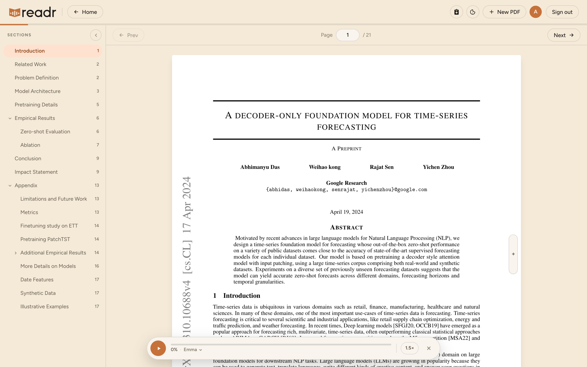
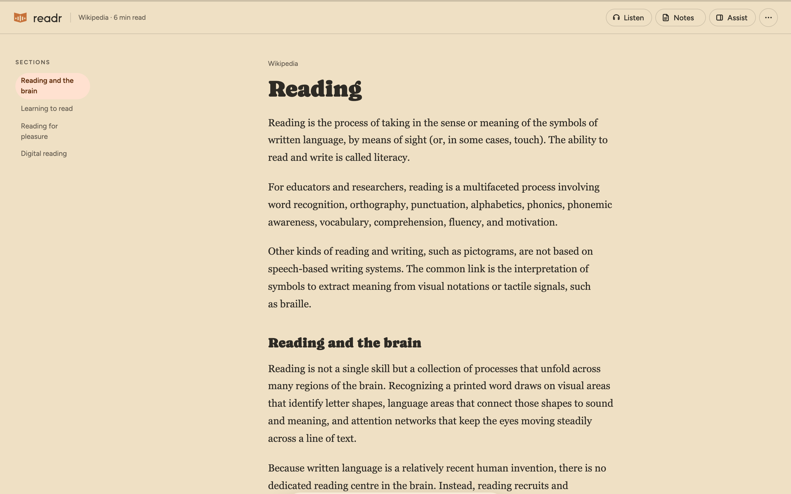
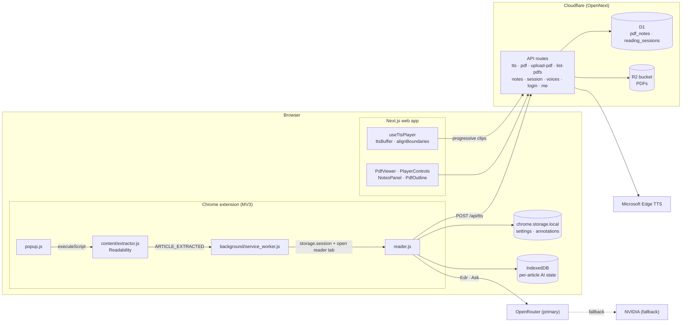
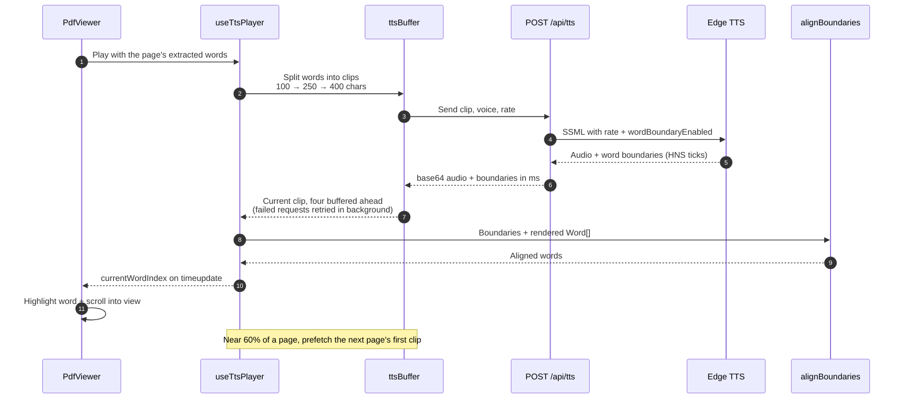
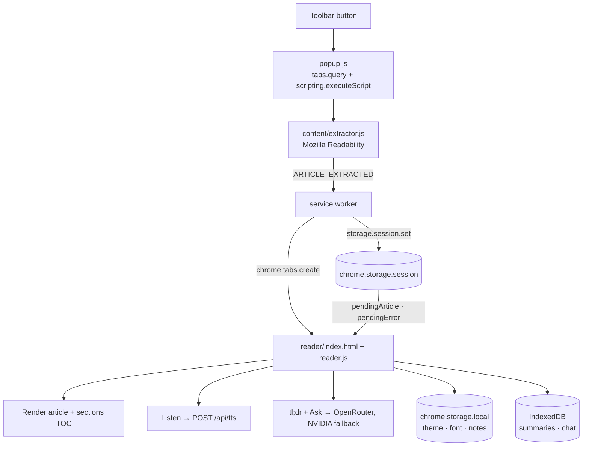

# Readr

A distraction-free reader with natural read-aloud. Open any article or PDF, and hear it read
with **word-by-word highlighting** in Microsoft Edge's neural voices.

Two apps in one repo:

- **Chrome extension:** turns any web page into a clean reader view with read-aloud, highlights
  and notes, a tl;dr summary, and "Ask" chat about the article.
- **Web app:** upload PDFs and listen to them with synced highlighting, a sections sidebar, and
  notes. Runs on Cloudflare Workers (D1 + R2).

> **Personal project, self-hosted.** Readr is built for personal use: you run your own copy with
> your own keys. There is no hosted public instance.

> [!WARNING]
> **Read-aloud uses an unofficial endpoint.** Text-to-speech goes through the endpoint behind
> Microsoft Edge's built-in Read Aloud feature (via [`msedge-tts`](https://www.npmjs.com/package/msedge-tts)).
> It is not a documented or supported Microsoft API. It needs no key, but it can change or stop
> working at any time, and using it may be subject to Microsoft's terms. Use it for personal
> projects at your own risk.

## Screenshots

### Web app



### Chrome extension



## Stack

- **Web:** Next.js 15 (App Router, TypeScript), Tailwind CSS, `pdfjs-dist`, deployed to Cloudflare
  Workers with [OpenNext](https://opennext.js.org/cloudflare); D1 for notes and sessions, R2 for PDFs
- **Extension:** Chrome Manifest V3, plain JavaScript bundled with Bun, Mozilla Readability
- **TTS:** Microsoft Edge neural voices with word boundaries (see the warning above)
- **AI (extension only):** OpenRouter, with NVIDIA as an optional fallback
- **Repo:** pnpm workspace, Biome, commitlint + Husky

## Requirements

- Node.js 24 (see `.nvmrc`) and [pnpm](https://pnpm.io) 11
- [Bun](https://bun.sh) to build the extension
- Chrome (or another Chromium browser) to load the extension
- For deploying the web app: a free [Cloudflare](https://dash.cloudflare.com/sign-up) account
- For extension summaries/chat (optional): an [OpenRouter](https://openrouter.ai) API key

## Run it locally

### 1. Install

```bash
git clone https://github.com/udyan-upal/readr.git
cd readr
pnpm install
```

### 2. Web app

```bash
cp apps/web/.env.example apps/web/.env.local
pnpm --filter @readr/web dev
```

Open [http://localhost:3030](http://localhost:3030). Fill in `apps/web/.env.local`:

| Variable | What it is |
|---|---|
| `ADMIN_USERNAME`, `ADMIN_PASSWORD` | The single login for your instance |
| `AUTH_SECRET` | Signs session tokens. Generate with `openssl rand -base64 48` |
| `EXT_API_TOKEN` | Shared token the extension sends to `/api/tts`. Generate with `openssl rand -hex 32` |

### 3. Chrome extension

```bash
cp apps/extension/.env.example apps/extension/.env.local
cd apps/extension
bun run dev        # watches and rebuilds dist/; use `bun run build` for a one-off build
```

Fill in `apps/extension/.env.local`:

| Variable | What it is |
|---|---|
| `EDGE_TTS_API_URL` | Your web app's TTS endpoint, e.g. `http://localhost:3030/api/tts` |
| `EDGE_TTS_API_TOKEN` | Same value as the web app's `EXT_API_TOKEN` |
| `OPENROUTER_API_KEY`, `OPENROUTER_MODEL` | Optional. Enables tl;dr and Ask (e.g. `openai/gpt-4o-mini`) |
| `NVIDIA_API_KEY` | Optional fallback AI provider |

These values are **built into the extension's JavaScript**, so rebuild after changing them, and
don't share your built extension (see [SECURITY.md](SECURITY.md)).

Load it in Chrome:

1. Open `chrome://extensions` and turn on **Developer mode**.
2. Click **Load unpacked** and select `apps/extension/dist/`.
3. After a rebuild, click the reload icon on the extension's card.

## Deploy your own (Cloudflare Workers)

The web app deploys to Cloudflare's free plan. Run these from `apps/web`:

```bash
npx wrangler login

# Create your own database and bucket, then put their names/IDs in wrangler.jsonc
npx wrangler d1 create readr-db                # copy the database_id it prints
npx wrangler r2 bucket create <your-bucket-name>
npx wrangler d1 migrations apply readr-db --remote

# Secrets (same meaning as in .env.local)
npx wrangler secret put ADMIN_USERNAME
npx wrangler secret put ADMIN_PASSWORD
npx wrangler secret put AUTH_SECRET
npx wrangler secret put EXT_API_TOKEN

pnpm run cf:deploy
```

`wrangler.jsonc` in this repo points at the maintainer's D1 database and R2 bucket. Replace
`database_id` and `bucket_name` with your own before deploying.

Then set `EDGE_TTS_API_URL` in the extension to `https://<your-worker>.workers.dev/api/tts` and
rebuild it.

**Free plan note:** Workers on the free plan get 10ms of CPU per request, and TTS requests often
go over it, so Cloudflare rejects some of them with a 503. Readr handles this: it requests short
clips, buffers four ahead while you listen, and retries failed ones in the background, so
playback normally doesn't stall. Cloudflare's paid Workers plan removes the limit.

## Contributing

Contributions are welcome. Read [CONTRIBUTING.md](CONTRIBUTING.md) for setup, commit
conventions, and the PR process, and follow the [Code of Conduct](CODE_OF_CONDUCT.md).
Report security issues privately as described in [SECURITY.md](SECURITY.md).

## Features

- Drag-and-drop PDF upload (max 20MB)
- Two-panel layout: PDF canvas preview (left) + extracted text with live highlighting (right)
- Voice picker grouped by locale (20+ neural voices, English prioritized; Bengali, Hindi, French, German, Spanish, Japanese, Chinese, Korean included)
- Speed control: 0.5x / 0.75x / 1x / 1.25x / 1.5x / 2x — changes playback speed without regenerating audio
- Play / Pause / Stop + progress bar
- Word-by-word highlight follows audio playback; active word auto-scrolls into view
- Keyboard shortcuts: **Space** = play/pause · **←/→** = prev/next page
- Dark-mode ready (Tailwind `dark:` classes; toggles with system theme)

## Architecture

### System overview



The web app talks only to its own API routes. The extension is an independent MV3
bundle: it reuses the web app's `/api/tts` endpoint for read-aloud, calls the AI
providers directly, and keeps its own state in `chrome.storage` and IndexedDB.

### Read-aloud pipeline



### Extension capture flow



### API routes

- `POST /api/tts` — body `{ text, voice, rate? }`, returns `{ audio: base64, boundaries: WordBoundary[] }`. Uses `msedge-tts` with `wordBoundaryEnabled`. Microsoft offsets are HNS (100-ns ticks) and are converted to ms by `/ 10000`. `runtime = 'nodejs'` (edge runtime is incompatible with `msedge-tts`'s WebSocket client).
- `GET /api/voices` — returns the curated voice list.

### Client

- `app/page.tsx` — orchestrates upload, page state, playback.
- `components/PdfViewer.tsx` — dynamically imports `pdfjs-dist`, renders the current page to canvas, and extracts text for every page once the file is loaded. Worker loaded from cdnjs matching the installed pdfjs version.
- `components/PlayerControls.tsx` — renders playback, voice, speed, and progress controls.
- `hooks/useTtsPlayer.ts` — owns the `<audio>` element, blob URL lifecycle, and `currentWordIndex` derivation from `timeupdate`.
- `lib/alignBoundaries.ts` — two-pointer alignment between TTS word boundaries and rendered words (handles punctuation, contractions, hyphenation drift).

### Tricky bits (commented in source)

- **HNS → ms:** `offsetMs = Offset / 10_000`
- **PDF.js worker:** `GlobalWorkerOptions.workerSrc` points at cdnjs with `pdfjs.version`
- **Boundary alignment:** TTS tokens don't match whitespace-split words 1:1; `alignBoundaries` walks both arrays, normalizing (lowercase, strip punctuation), interpolating when one boundary covers multiple rendered words
- **Speed:** audio is always synthesized at normal speed (`rate: "+0%"`) and sped up with the audio element's `playbackRate`, so changing speed doesn't refetch audio and word timings stay on the media timeline

## Limits

- No OCR — scanned/image PDFs require OCR before their text can be read.

## License

[MIT](LICENSE) © Udyan Saha Upal
